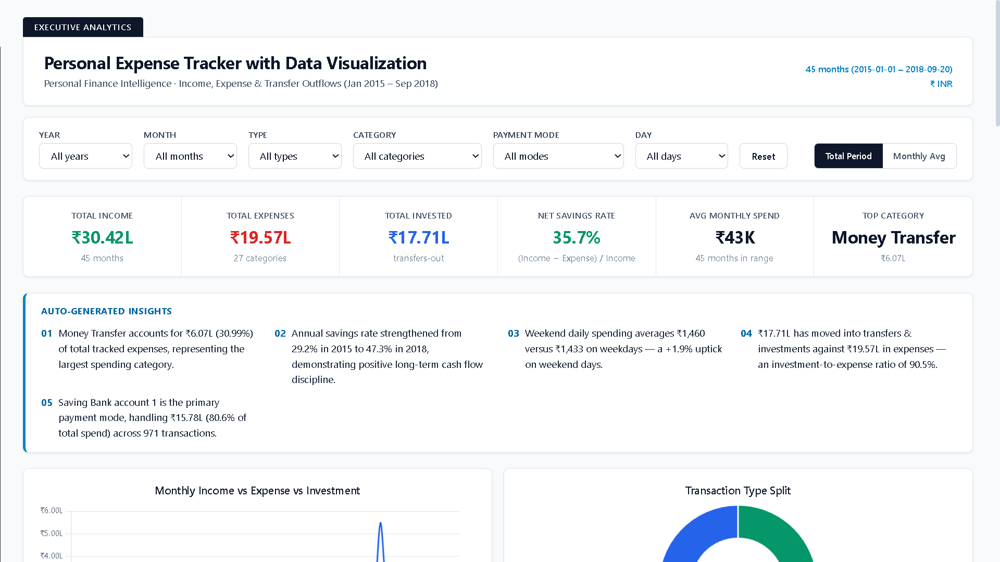
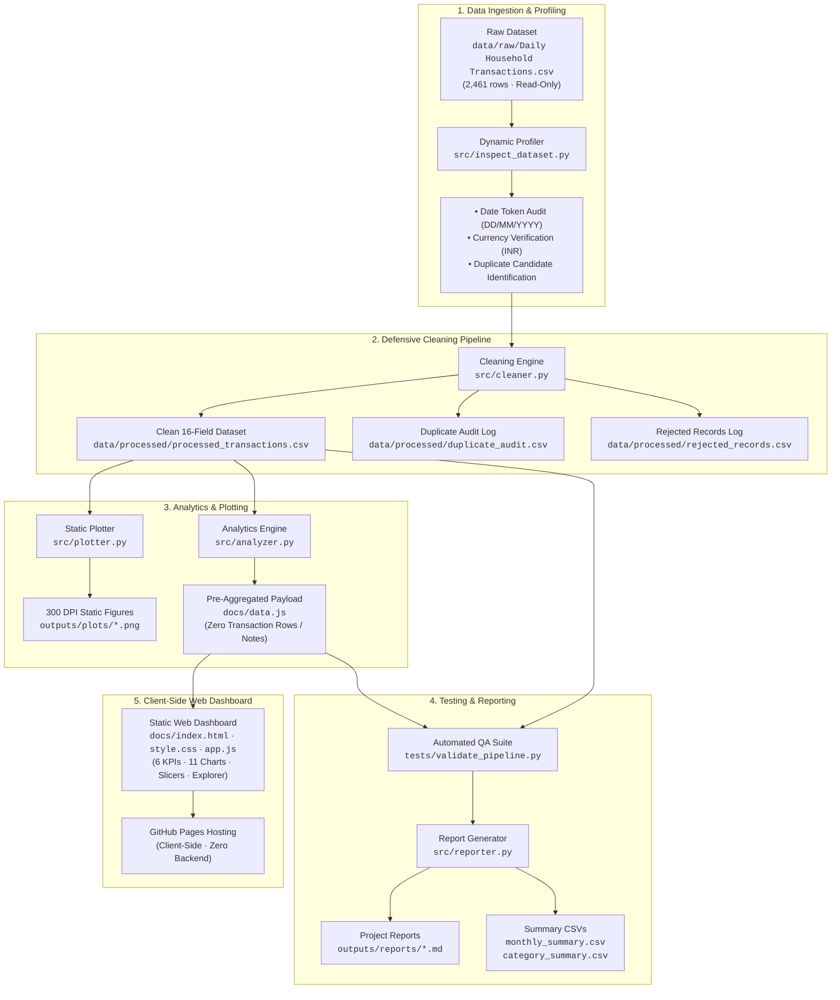

<div align="center">

# PERSONAL EXPENSE TRACKER WITH DATA VISUALIZATION

### **A Python and Vanilla Web Application for Household Expense Tracking, Financial Analytics, and Interactive Visualization**

[](LICENSE)
[](https://creativecommons.org/publicdomain/zero/1.0/)
[](https://www.python.org/)
[](https://pandas.pydata.org/)
[](https://matplotlib.org/)
[](https://www.chartjs.org/)
[](tests/)
[](https://girishshenoy16.github.io/personal-expense-tracker/)

---

A Python-based personal expense tracking application and data visualization pipeline designed to analyze multi-year household financial transactions. The system cleans raw transaction records, categorizes spending, tracks cash burn and savings, and presents findings through both publication-quality static charts and an interactive, client-side web dashboard deployed via GitHub Pages.

[**Live Dashboard**](https://girishshenoy16.github.io/personal-expense-tracker/) | [**Project Report**](outputs/reports/project_report.md) | [**Executive Summary**](outputs/reports/executive_summary.md)

---

## 1. Live Demo and Dashboard Preview

[](https://girishshenoy16.github.io/personal-expense-tracker/)

*Figure 1: Interactive Personal Expense Tracker web dashboard deployed on GitHub Pages.*

👉 **[Access the Personal Expense Tracker Dashboard](https://girishshenoy16.github.io/personal-expense-tracker/)**

</div>

---

## 2. Overview and Problem Statement

Tracking personal expenses across multiple years is challenging when working with raw, inconsistent transaction exports:

* **Conflating Transfers with Expenses**: Standard budgeting tools often classify bank-to-bank transfers or investments (e.g., Public Provident Fund, Mutual Funds) as living expenses, which artificially depresses true savings and distorts household burn rate.
* **Silent Date Format Issues**: Transaction logs often mix day-first (`DD/MM/YYYY`) and month-first (`MM/DD/YYYY`) formats, leading to incorrect monthly aggregations if parsed naively.
* **Aggressive Deduplication**: Generic deduplication functions frequently drop legitimate everyday recurring transactions, such as two identical commuter transit fares on the same day.
* **Privacy Risks**: Sharing financial dashboards online can accidentally expose sensitive merchant descriptions, medical notes, or transaction IDs.

### How This Project Solves These Issues

1. **Defensive Data Cleaning**: Dynamically inspects date token boundaries, audits candidate duplicates to preserve legitimate recurring transactions, and normalizes records into a clean 16-field schema.
2. **Proper Financial Accounting**: Strictly separates capital transfers-out from operational living expenses, preserving accurate cash flow and savings rate calculations.
3. **Privacy-Preserving Web Publishing**: The web dashboard consumes only pre-aggregated summary tables (`docs/data.js`), ensuring no transaction-level rows, IDs, or free-text notes are ever published online.
4. **Interactive Static Visualization**: Combines 5 publication-ready 300 DPI Matplotlib charts with a responsive, client-side Chart.js dashboard running with zero backend server dependencies.

---

## 3. Key Features

The project implements the following capabilities in prioritized order:

### 3.1 Transaction Management and Transaction History
* **Historical Ingestion & Processing**: Processes **2,461 historical household transactions** spanning **1,359 calendar days** (2015-01-01 to 2018-09-20).
* **Surrogate Transaction Identifiers**: Assigns deterministic sequential identifiers (`GEN-TXN-0001` through `GEN-TXN-2461`) after chronological sorting.
* **Conservative Duplicate Auditing**: Audited 14 candidate duplicate rows sharing identical dates, amounts, and categories; verified and retained all 14 as legitimate distinct everyday transactions with status `retained_ambiguous_duplicate` in `data/processed/duplicate_audit.csv`.
* **Row-Count Reconciliation**: Verified 100% accounting balance: $2,461 \text{ raw records} \equiv 2,461 \text{ retained} + 0 \text{ rejected} + 0 \text{ deduplicated}$.
* *Scope Note*: Current implementation processes historical transactions via a batch Python pipeline; interactive in-browser CRUD (adding, editing, or deleting single transactions directly in the web UI) is documented under [Limitations and Future Scope](#11-limitations-and-future-scope).

### 3.2 Income and Expense Categorization
* **Three-Way Transaction Classification**: Strictly partitions records into `Income` (inflow), `Expense` (operational living consumption), and `Transfer-Out` (balance-sheet capital movements).
* **Category Hierarchy**: Maps spending into 27 standardized categories with subcategories. Missing subcategories are safely imputed with `'General'` while preserving parent category integrity.
* **Spending Concentration**: Identifies primary expenditure drivers, led by Money Transfer (30.99%), Investment (13.89%), Transportation (8.64%), Household (8.26%), and Food (4.93%).
* **Payment Mode Tracking**: Tracks outflow across 5 payment instruments: Saving Bank Account 1 (80.60%), Credit Card (10.49%), Cash (8.86%), Debit Card (0.05%), and Saving Bank Account 2 (<0.01%).

### 3.3 Budget Management and Tracking
* **Operational Cash Surplus Margin**: Tracks overall savings efficiency ($M_s = 35.66\%$) against total cash inflows.
* **Daily Burn Rate Monitoring**: Calculates average operational burn rate ($₹1,440.32/\text{day}$) using the full 1,359 calendar day span as the denominator, avoiding upward bias from active-day counting.
* **Temporal Burn Analysis**: Compares weekday burn ($₹1,432.63/\text{day}$) against weekend burn ($₹1,459.54/\text{day}$, +1.88% higher).
* *Scope Note*: The project monitors historical cash burn and surplus rates against inflows; setting arbitrary user-defined monthly category budget caps and real-time threshold alerts is documented under [Limitations and Future Scope](#11-limitations-and-future-scope).

### 3.4 Essential Financial KPIs and Summaries

<div align="center">

| Core Financial Metric                    |     Measured Value      | Domain & Methodological Formulation                                            |
|:-----------------------------------------|:-----------------------:|:-------------------------------------------------------------------------------|
| **Observation Window**                   | **1,359 Calendar Days** | 45 calendar months (2015-01-01 to 2018-09-20)                                  |
| **Total Cash Inflow (Income)**           |    **₹3,042,397.35**    | Operational cash earnings, salary, and capital interest                        |
| **Total Operational Outflow (Expenses)** |    **₹1,957,390.53**    | Operational living consumption expenditure                                     |
| **Total Transfers-Out (Investments)**    |    **₹1,770,780.90**    | Isolated capital reallocations (Mutual Funds, PPF, transfers)                  |
| **Net Cash Flow (NCF)**                  |    **₹1,085,006.82**    | $\text{NCF} = \text{Income} - \text{Expenses}$ (Operational liquidity surplus) |
| **Operational Surplus Margin**           |       **35.66%**        | $M_s = [(\text{Income} - \text{Expenses}) / \text{Income}] \times 100$         |
| **Daily Average Burn Rate**              |   **₹1,440.32 / day**   | $\text{Expenses} / 1,359 \text{ calendar days}$ (Calendar span denominator)    |
| **Weekday Daily Average Spend**          |   **₹1,432.63 / day**   | Total Weekday Outflow (₹1,391,087.40) / 971 calendar weekdays                  |
| **Weekend Daily Average Spend**          |   **₹1,459.54 / day**   | Total Weekend Outflow (₹566,303.13) / 388 calendar weekend days (+1.88%)       |

</div>

### 3.5 Filtering and Data Exploration
* **6 Interactive Slicers**: Multi-select filters for Year, Month, Transaction Type, Category, Payment Mode, and Day-of-Week.
* **Scale Toggle & Reset**: Global Reset button and a Total Period vs. Monthly Average toggle.
* **Subcategory Drill-Down**: Interactive category breakdown panel displaying itemized subcategories, transaction counts, and percentage shares.
* **Aggregated Data Explorer**: Centered 5-record table with compact Previous/Next pagination, record-count indicators (`Showing 1–5 of 27 categories`), and scaling notes.

### 3.6 Charts and Data Visualization
* **11 Interactive Chart.js Visualizations** in the web dashboard:
  1. *Income & Expense Multi-Period Trajectory* (Line chart)
  2. *Transaction Type Breakdown* (Doughnut chart)
  3. *Top 10 Spending Categories* (Horizontal bar chart)
  4. *Payment Mode Allocation* (Doughnut chart)
  5. *Weekday vs. Weekend Spending* (Comparative bar chart)
  6. *Net Cash Flow & Savings Trajectory* (Monthly bar chart)
  7. *Year-over-Year Burn Comparison* (Grouped annual bar chart)
  8. *Investment & Transfer Allocations* (Portfolio doughnut chart)
  9. *Day-of-Week Spending Distribution* (Radar / bar chart)
  10. *Frequency vs. Ticket Size* (Bubble chart)
  11. *Cumulative Net Cash Flow* (Area trajectory chart)
* **5 Static Publication Plots** generated by `src/plotter.py` at 300 DPI in `outputs/plots/`.

### 3.7 Data Export and Reporting
* **Filter-Aware CSV Export**: Downloads aggregated data directly from the web dashboard explorer matching active slicer selections.
* **Automated Summary CSVs**: `outputs/reports/monthly_summary.csv` (45 monthly records) and `outputs/reports/category_summary.csv` (27 category records).
* **Consolidated Project Report**: `outputs/reports/project_report.md` (12.63 KB) with complete statistical profiling, formulas, and audit results.

---

## 4. Technology Stack

<div align="center">

| Domain                     | Technology                     | Operational Purpose                                                          |
|:---------------------------|:-------------------------------|:-----------------------------------------------------------------------------|
| **Language & Runtime**     | Python 3.11+                   | Core data processing pipeline, financial analytics, and orchestrator         |
| **Data Processing & ETL**  | Pandas 3.0.6                   | Tabular ingestion, defensive cleaning, feature engineering, and aggregations |
| **Numerical Calculations** | NumPy 2.4.6                    | Vectorized financial arithmetic, array calculations, and moving averages     |
| **Date & Time Parsing**    | python-dateutil 2.9.0          | Defensive ISO-8601 calendar date and timestamp parsing                       |
| **Static Visualizations**  | Matplotlib 3.11.2              | High-resolution 300 DPI chart generation (`outputs/plots/*.png`)             |
| **Image Verification**     | Pillow 12.3.0                  | Static image dimension auditing and file integrity checks                    |
| **Testing Framework**     | Pytest 9.1.1 + unittest        | Automated 51-test Pytest suite & standalone 7-point pipeline validation      |
| **Frontend Dashboard**     | JavaScript (ES6+), HTML5, CSS3 | Power BI-inspired static executive dashboard deployed via GitHub Pages       |
| **Interactive Charting**   | Chart.js 4.4.4                 | Client-side reactive canvas charting with INR currency tooltips              |
| **Logging & Resilience**   | logging (RotatingFileHandler)  | Size-based log rotation, sensitive note masking, and `sys.stderr` fallback   |
| **Static Hosting**         | GitHub Pages                   | Zero-cost serverless hosting directly from the `/docs` directory             |

</div>

---

## 5. System Architecture



---

## 6. Installation and Usage

### Prerequisites
* **Python**: Version `3.11` or higher
* **Git**: Installed and available in PATH
* **Modern Web Browser**: Chrome, Edge, Firefox, or Safari

### Setup Instructions

#### Windows (PowerShell):
```powershell
# Clone the repository
git clone https://github.com/girishshenoy16/personal-expense-tracker.git
cd personal-expense-tracker

# Create and activate an isolated virtual environment
python -m venv venv
.\venv\Scripts\activate

# Upgrade pip and install minimal dependencies
python -m pip install --upgrade pip
pip install -r requirements.txt
```

#### macOS / Linux (Bash):
```bash
# Clone the repository
git clone https://github.com/girishshenoy16/personal-expense-tracker.git
cd personal-expense-tracker

# Create and activate an isolated virtual environment
python3 -m venv venv
source venv/bin/activate

# Upgrade pip and install minimal dependencies
python3 -m pip install --upgrade pip
pip install -r requirements.txt
```

### Execution Commands

```bash
# Run the complete automated test suite with Pytest (51 tests)
python -m pytest

# Run individual test modules
python -m pytest tests/test_financial_metrics.py
python -m pytest tests/test_data_validation.py
python -m pytest tests/test_pipeline.py
python -m pytest tests/test_reports.py
python -m pytest tests/test_logger_resilience.py

# Run specific test subsets by marker
python -m pytest -m unit
python -m pytest -m integration

# Run the standalone 7-point production dataset validation suite
python tests/validate_pipeline.py

# Run the complete end-to-end pipeline in sequence (~7.5 seconds)
python main.py

# Preview the web dashboard locally
python -m http.server 8000 -d docs
# Open browser at: http://localhost:8000
```

---

## 7. Folder Structure

```text
Personal Expense Tracker with Data Visualization/
│
├── data/                                   
│   ├── raw/
│   └── processed/
│
├── docs/                                    # Static GitHub Pages web dashboard
│   ├── index.html                           # Power BI-inspired dashboard markup
│   ├── style.css                            # Dashboard styling, responsive grid, contrast
│   ├── app.js                               # Slicers, 6 KPI cards, 11 Chart.js charts, Explorer
│   └── data.js                              # Pre-aggregated public data payload (zero transaction rows)
│
├── src/                                     # Core Python data engineering & analytics engine
│   ├── __init__.py                          # Package marker
│   ├── logger.py                            # Centralized logging, note masking, stderr fallback
│   ├── inspect_dataset.py                   # Dynamic raw dataset profiler & format auditor
│   ├── cleaner.py                           # Defensive cleaning, duplicate audit, surrogate IDs
│   ├── analyzer.py                          # Financial KPI engine, edge-case guards, payload export
│   ├── plotter.py                           # Publication-grade 300 DPI Matplotlib plotting suite
│   └── reporter.py                          # Authoritative report compiler & summary CSV exporter
│
├── outputs/                                 # Generated analytical deliverables
│   ├── plots/                               # Static 300 DPI analytical visualization suite
│   └── reports/                             # Authoritative documentation & summary exports
│       ├── executive_summary.md             # Strategic executive scorecard & household recommendations
│       ├── project_report.md                # Comprehensive authoritative project report (12.63 KB)
│       ├── monthly_summary.csv              # 45-month trend summary (Income, Expense, NCF, MoM, SMA3)
│       └── category_summary.csv             # 27-category expenditure breakdown & subcategories
│
├── tests/                                   # Automated Quality Assurance test suites
│   ├── __init__.py                          # Test package marker
│   ├── conftest.py                          # Reusable pytest fixtures & synthetic test datasets
│   ├── test_financial_metrics.py            # Unit tests for financial formulas & KPIs (22 tests)
│   ├── test_data_validation.py              # Unit tests for schema, cleaning & dates (14 tests)
│   ├── test_logger_resilience.py            # Unit tests for privacy masking & stderr fallback (6 tests)
│   ├── test_pipeline.py                     # Integration tests for end-to-end pipeline (5 tests)
│   ├── test_reports.py                      # Unit tests for report & CSV generation (4 tests)
│   └── validate_pipeline.py                 # Standalone 7-point production dataset validation suite
│
├── main.py                                  # Unified master pipeline orchestrator
├── pytest.ini                               # Pytest discovery, marker, and verbosity configuration
├── requirements.txt                         # Pinned Python dependencies (pandas, matplotlib, pytest)
├── .gitignore                         
├── LICENSE                                  # MIT Software License
└── README.md                                # Master GitHub portfolio documentation
```

---

## 8. Financial Calculations and Data Handling

### 8.1 Inflows, Outflows, and Transfer Isolation
* **Total Income ($I$)**: Sum of all records classified as `Income` ($₹3,042,397.35$).
* **Total Expenses ($E$)**: Sum of all records classified as `Expense` ($₹1,957,390.53$).
* **Transfers-Out ($T$)**: Sum of all records classified as `Transfer-Out` ($₹1,770,780.90$).
* **Domain Isolation Rule**: Transfers-Out represent balance-sheet movements into investments (Mutual Funds, PPF, Fixed Deposits) and inter-account transfers. They are strictly excluded from living consumption expenses to prevent distorting savings and burn rate metrics.

### 8.2 Net Cash Flow ($\text{NCF}$)
$$\text{NCF} = I - E = ₹3,042,397.35 - ₹1,957,390.53 = ₹1,085,006.82$$
Represents net operational cash surplus generated over the observation period.

### ### 8.3 Operational Cash Surplus Margin (`M_s`)

$$
M_s =
\begin{cases}
\left( \frac{I - E}{I} \right) \times 100\%, & \text{if } I > 0 \\
\text{N/A}, & \text{if } I = 0
\end{cases}
$$

Evaluated across the 45-month period: **35.66%**.

### 8.4 Daily Average Burn Rate ($B_d$)
$$
B_d = \frac{E}{N_{\text{calendar days}}}
= \frac{₹1,957,390.53}{1,359\text{ days}}
= ₹1,440.32 / \text{day}
$$

Uses the total calendar day span ($T_{\max} - T_{\min} + 1 = 1,359 \text{ days}$) as the denominator, avoiding upward distortion from active-day counting.

### 8.5 Weekday vs. Weekend Daily Spend
* **Weekday Daily Average**: $₹1,391,087.40 / 971 \text{ weekdays} = ₹1,432.63/\text{day}$.
* **Weekend Daily Average**: $₹566,303.13 / 388 \text{ weekend days} = ₹1,459.54/\text{day}$ (+1.88% higher).

### 8.6 Trailing 3-Month Moving Average ($\text{SMA}_3$) and MoM Growth
$$\text{SMA}_{3, t} = \frac{E_t + E_{t-1} + E_{t-2}}{3}$$
* **Consecutiveness Guard**: Verifies that preceding calendar months are strictly adjacent: $(Y_t \cdot 12 + M_t) - (Y_{t-1} \cdot 12 + M_{t-1}) == 1$. If months are non-consecutive, the algorithm returns `null` or `N/A` rather than averaging non-adjacent periods.

---

## 9. Privacy and Dataset Attribution

### Privacy Boundary
The project adheres to a strict publication policy to protect personal financial privacy:
* **Local Data**: The complete 16-field transactional dataset (`data/processed/processed_transactions.csv`), candidate duplicate logs, and free-text transaction notes remain strictly local for pipeline calculations and automated test reconciliation.
* **Public Deliverables**: The web dashboard consumes strictly pre-aggregated summary tables (`docs/data.js`). Zero individual transaction rows, surrogate transaction IDs, precise timestamps, or personal notes are exposed in public web assets.

### Dataset Attribution
* **Dataset Title**: *Daily Household Transactions*
* **Author / Curator**: Prasad Patil on Kaggle
* **Dataset License**: Public Domain ([Creative Commons CC0 1.0 Universal](https://creativecommons.org/publicdomain/zero/1.0/))
* **Raw Integrity**: Verified read-only raw storage (`data/raw/Daily Household Transactions.csv`) with SHA-256 hash `809F267062E4333D3E05532D9D1B2568FCED670A1C2BCBA141BDB80344E6CFC1`.

---

## 10. Testing and Validation

The automated testing layer consists of **160 verification checks** across Pytest unit and integration suites, standalone production dataset validation, and client-side browser testing with a **100% pass rate (0 failures)**:

<div align="center">

| Test Suite Module                 | File Path                           | Checks | Validated Requirements & Assertions                                                                          | Status  |
|:----------------------------------|:------------------------------------|:------:|:-------------------------------------------------------------------------------------------------------------|:-------:|
| **Financial Formulas & Metrics**  | `tests/test_financial_metrics.py`   |   22   | Inflow/outflow/transfers separation, NCF, cash surplus margin, daily burn rate, MoM growth, SMA3, Pareto shares  | ✅ PASS |
| **Data Cleaning & Schema**        | `tests/test_data_validation.py`     |   14   | 16-field schema conformance, empirical DD/MM/YYYY date/time parsing, duplicate audit, missing value defaults | ✅ PASS |
| **Logger Resilience & Security**  | `tests/test_logger_resilience.py`   |   6    | Account number masking, narrative note redaction, recursive arg sanitization, `sys.stderr` I/O fallback      | ✅ PASS |
| **Pipeline & Artifact Delivery**  | `tests/test_pipeline.py`            |   5    | Multi-stage temp-dir execution, artifact generation, payload privacy contract, Python vs JS parity           | ✅ PASS |
| **Report & CSV Compilation**      | `tests/test_reports.py`             |   4    | Monthly & category summary CSV headers/values, project report markdown, executive summary generation        | ✅ PASS |
| **Production Pipeline Parity**    | `tests/validate_pipeline.py`        |   7    | Standalone 7-point QA: schema, row-count reconciliation (2,461=2,461+0+0), NCF balance, 300 DPI plot checks  | ✅ PASS |
| **Explorer Pagination UI**        | `test_refinements.js`               |   41   | 5-row pagination, compact navigation, record count labels, filter-aware aggregated CSV export                | ✅ PASS |
| **Readability & Interactivity**   | `test_interactivity_readability.js` |   61   | Chart.js tooltips, hover highlights, legend toggles, click filtering, accessible contrast                    | ✅ PASS |
| **Headless Browser E2E**          | Chrome DevTools Protocol (CDP)      |  Full  | 0 console errors, 0 failed resource requests, 0 horizontal overflow across desktop, tablet, mobile           | ✅ PASS |
| **Total Automated Quality Suite** | **Full System Verification**        | **160 Checks** | **100% Pass Rate across Pytest, standalone Python, Node.js, and Headless Browser evaluations with 0 failures** | ✅ PASS |

</div>

### 10.1 Automated Pytest Workflow
The project configures Pytest via [`pytest.ini`](pytest.ini) with strict marker validation (`--strict-markers`), test discovery under `tests/`, and verbose output (`-ra`). Tests utilize isolated temporary directories (`tmp_path`) and deterministic fixtures from [`tests/conftest.py`](tests/conftest.py), guaranteeing zero side effects on production data:

* **Unit Tests (`-m unit`)**: 46 isolated unit tests verifying mathematical formulas, boundary guards, defensive date parsing, and logging filters without external side effects.
* **Integration Tests (`-m integration`)**: 5 end-to-end integration tests executing the multi-stage pipeline, static chart rendering, and artifact delivery in isolated temporary workspaces.

---

## 11. Limitations and Future Scope

### Limitations

<div align="center">

| Limitation Category               | Description & Impact                                       | Engineering Rationale & Mitigation                                                                         |
|:----------------------------------|:-----------------------------------------------------------|:-----------------------------------------------------------------------------------------------------------|
| **Batch Processing Mode**         | Processes historical transaction files via Python pipeline | Web UI does not provide in-browser CRUD (add/edit/delete); future versions can add local IndexedDB storage |
| **Historical Spend Tracking**     | Tracking calculates historical burn rates and cash surplus | Arbitrary user-defined monthly category budget caps and alerts are not supported in this version           |
| **Single Currency**               | Dataset is homogeneous INR currency records                | Currency conversion across foreign currencies is not included; forward-compatible with FX rate conversion  |
| **Static Pre-Aggregated Payload** | Public dashboard consumes static `docs/data.js` file       | Allows $0/mo serverless GitHub Pages hosting; dataset updates require re-running `python main.py`          |

</div>

### Future Scope

<div align="center">

|  Priority  | Feature Initiative             | Planned Enhancement                                                                                     |
|:----------:|:-------------------------------|:--------------------------------------------------------------------------------------------------------|
|  **High**  | In-Browser Transaction Entry   | Add local browser storage (IndexedDB) allowing users to add/edit transactions directly in the dashboard |
|  **High**  | Category Budget Caps & Alerts  | Enable users to set monthly spending limits per category with visual progress bars and warning alerts   |
| **Medium** | Multi-Currency Ingestion       | Support dynamic exchange rate conversion for multi-currency transactions via open FX rate APIs          |
| **Medium** | Automated GitHub Actions CI/CD | Automate test validation and data payload rebuilds on new dataset commits                               |

</div>

---

## 12. Reports and Documentation

<div align="center">

| Report                           | Document Path                                                                  | Target Audience                 | Key Contents                                                                          |
|:---------------------------------|:-------------------------------------------------------------------------------|:--------------------------------|:--------------------------------------------------------------------------------------|
| **Executive Summary Report**     | [`outputs/reports/executive_summary.md`](outputs/reports/executive_summary.md) | Executives, Mentors & Reviewers | Strategic financial scorecard, Pareto breakdown, burn dynamics & recommendations      |
| **Authoritative Project Report** | [`outputs/reports/project_report.md`](outputs/reports/project_report.md)       | Technical Reviewers & Assessors | Problem statement, EDA findings, mathematical formulas, test results, dependency pins |
| **Monthly Summary CSV**          | [`outputs/reports/monthly_summary.csv`](outputs/reports/monthly_summary.csv)   | Financial Analysts & Users      | 45-month aggregated trend series (Inflow, Outflow, Transfers, NCF, MoM, SMA3)         |
| **Category Summary CSV**         | [`outputs/reports/category_summary.csv`](outputs/reports/category_summary.csv) | Financial Analysts & Users      | 27-category expenditure hierarchy, transaction frequencies, and expenditure shares    |
</div>

---

## 13. Contact and License

### Contact

<div align="center">

**Girish Shenoy**

[](https://github.com/girishshenoy16)
[](https://linkedin.com/in/girishshenoys)
[](mailto:girishpshenoy09@gmail.com)

</div>

### License & Attribution
* **Software**: Released under the [MIT License](LICENSE) — Copyright (c) 2026 Girish Shenoy.
* **Dataset Attribution**: Prasad Patil, *Daily Household Transactions* on Kaggle. Released under the [Creative Commons CC0 1.0 Universal Public Domain Dedication](https://creativecommons.org/publicdomain/zero/1.0/).

---

<div align="center">

**Built with precision. Engineered for financial clarity. Documented for analytical rigor.**

Personal Expense Tracker with Data Visualization v1.0 — A Python & Vanilla Web Personal Finance Application

</div>
